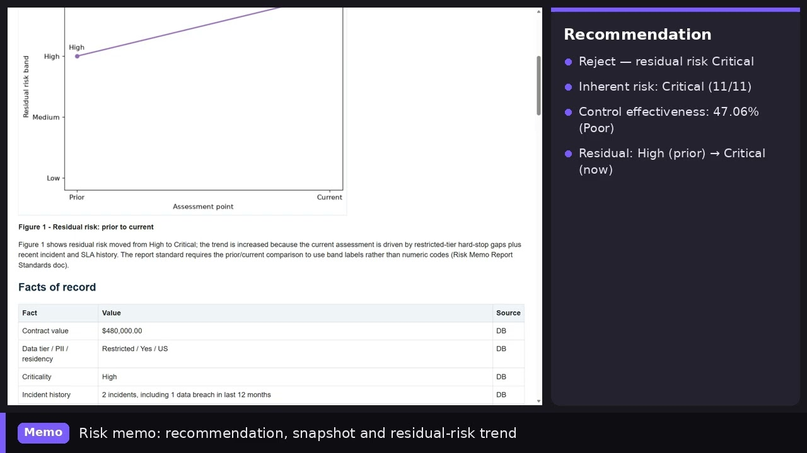
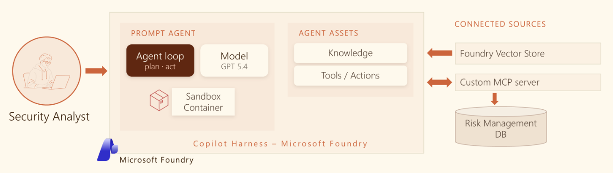

# Automating third-party vendor risk assessment with AI

Onboarding a new vendor means a GRC or security analyst reads a long security questionnaire,
cross-checks the vendor's history, applies the organisation's policy and writes a defensible
recommendation. The **Foundry Vendor Risk Agent** does that end to end and returns a one-page
summary plus a full HTML risk memo with charts — with a clear verdict:
**Approve, Approve with Conditions, or Reject.**

[▶ Watch the demo](https://youtu.be/4jcQ52ctDY0) ·
[📖 Read the article on LinkedIn](https://www.linkedin.com/pulse/copilot-harness-runtime-builds-agent-you-srikantan-sankaran-hgmac/) ·
[💻 Source code on GitHub](https://github.com/MSFT-Innovation-Hub-India/foundry-vendor-risk-agent)

## Why it matters to the business

- **Faster onboarding.** Assessment drops from days of analyst effort to minutes.
- **Consistent decisions.** Every vendor is judged against the same written policy and scoring method.
- **Auditable.** Each rule in the memo cites the policy passage it came from, and the scoring code is reproducible.
- **Safe by design.** The questionnaire is treated as evidence, not instructions, so a planted
  "already pre-approved" line cannot sway the outcome. Database access is read-only through
  parameterised MCP tools.

## How it works

1. The analyst gives a one-line instruction and the vendor's questionnaire.
2. The agent retrieves control requirements, scoring rules and thresholds from the TPRM policy library (vector search).
3. It fetches the vendor's facts of record — profile, incidents, SLA breaches, prior assessments — from Azure SQL through a read-only **MCP** server.
4. It writes and runs scoring code in the Copilot harness sandbox, self-correcting until the control checks tie out, and renders charts.
5. It publishes a self-contained HTML report to a small report-viewer app and replies with the summary, verdict and link.

## Technology

Microsoft Foundry · Copilot harness (sandbox, file system, shell) · Model Context Protocol (MCP) · Azure SQL ·
Azure Container Apps · managed identity · vector search.

## Worked examples

- [Acme Analytics — Reject](walkthrough_acme.md): Restricted data tier, hard-stop control gaps, prior breach.
- [Northwind Logistics — Approve](walkthrough_northwind.md): Internal tier, clean history.
- [Data sources](data_sources.md): the vendor database and the policy library the agent draws on.

## Get the code

Everything — database schema and seed data, MCP server, report viewer, policy library, agent
instructions and sample questionnaires — is in the
[GitHub repository](https://github.com/MSFT-Innovation-Hub-India/foundry-vendor-risk-agent),
with a step-by-step [deployment guide](https://github.com/MSFT-Innovation-Hub-India/foundry-vendor-risk-agent/blob/main/DEPLOYMENT.md).
